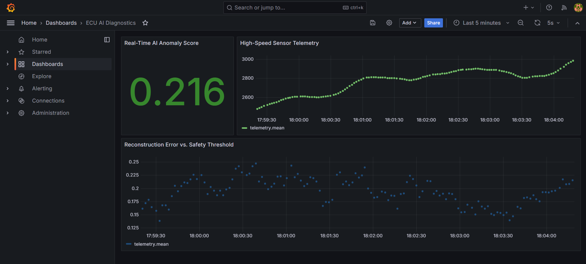
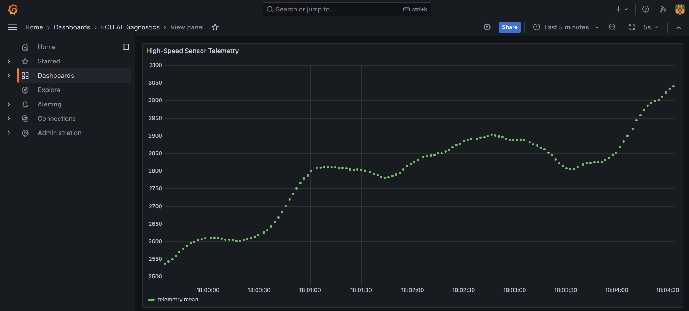
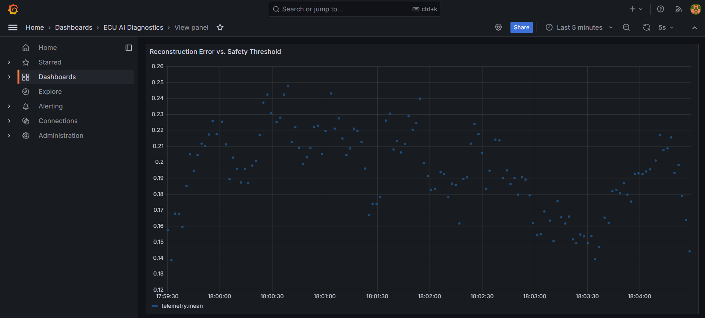
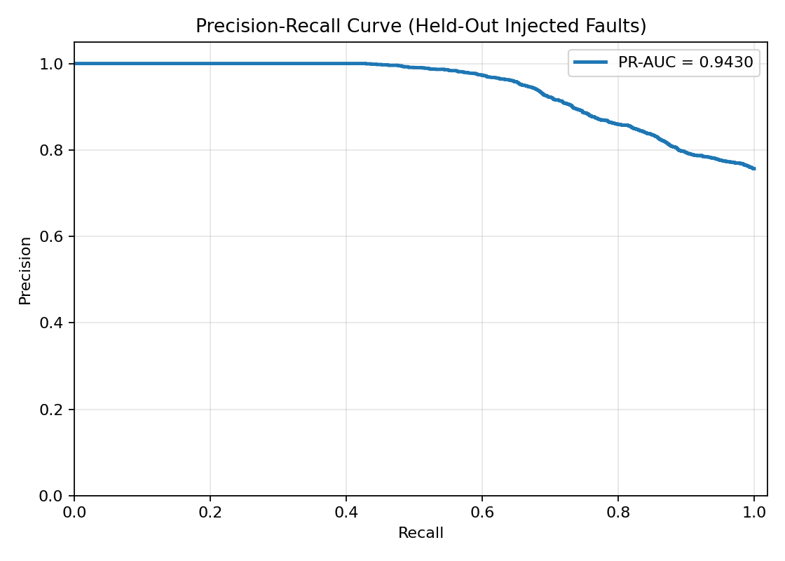
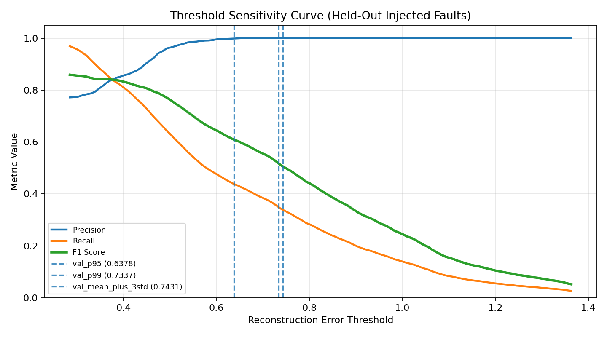

# ECU Telemetry Anomaly Detection & Diagnostics Pipeline

An end-to-end time-series anomaly detection and diagnostics pipeline for **replayed ECU telemetry**. It combines an unsupervised **LSTM Autoencoder** (`50`-step sliding windows across `12` features), **FastAPI** serving, **InfluxDB** time-series storage, **Grafana** monitoring, and **Docker Compose** orchestration—evaluated against static rule, PCA, and Isolation Forest baselines on `100` injected fault episodes.

> **Honest Scope:** Telemetry is replayed from drive-cycle feature logs and evaluated with reproducible synthetic fault injection on a local Docker Compose stack—not a physical HIL bench or live factory-floor deployment.

---

## Problem Statement

Static single-signal thresholds miss subtle cross-sensor faults and state-dependent anomalies (for example, elevated temperature alongside low/idle RPM when individual signals still sit near plausible operating ranges), while manual log review is slow during test runs. Training purely on healthy drive-cycle data allows an unsupervised sequence model to learn normal multi-channel temporal patterns and flag deviations without requiring labeled fault data upfront.

---

## Approach & System Architecture

1. **Leak-Free Contiguous Splitting:** `data/features/baseline_features.csv` (`8,996` rows, `12` features, `50`-step windows, `10 Hz`) is split chronologically without random window shuffling into **Train** (`0:5397`, `5,397` rows, `60%`), **Validation** (`5397:7196`, `1,799` rows, `20%`), and **Test** (`7196:8996`, `1,800` rows, `20%`).
2. **Unsupervised Sequence Modeling:** An **LSTM Autoencoder** reconstructs `50`-step windows across `12` ECU telemetry features (`throttle_position`, `engine_rpm`, `coolant_temp`, `battery_voltage`, `map_sensor`, and `lambda_sensor` mean/std channels).
3. **Validation-Only Thresholding:** Thresholds (`Val P95 = 0.6378`, `Val P99 = 0.7337`, `Val Mean+3Std = 0.7431`) are derived strictly on healthy validation reconstruction errors rather than tuned on test faults.
4. **Root-Cause & Latency Diagnostics:** Per-feature reconstruction error ranks which signal deviated most during alerted windows, and episode evaluation tracks detection lag from fault onset to first alert.
5. **Local Containerized Monitoring:** Scored telemetry streams into **InfluxDB** and renders on **Grafana** via **Docker Compose**.

---

## Grafana Dashboard & Evaluation Curves

### Live / Replayed Monitoring Dashboard (Local Docker Compose Stack)

| Full Diagnostics View | High-Speed Sensor Telemetry Panel | Reconstruction Error Panel |
| :---: | :---: | :---: |
|  |  |  |

### Held-Out Injected Fault Evaluation Curves

| Precision-Recall Curve | Threshold Sensitivity Curve |
| :---: | :---: |
|  |  |

---

## Evaluation Results (`112` Test Episodes: `12` Healthy + `100` Fault-Injected, `11,312` Windows)

### 1. Model & Baseline Comparison

| Model / Variant | Threshold | Precision | Recall | F1 | Accuracy | ROC-AUC | PR-AUC | Healthy False-Alarm Rate |
| :--- | :---: | :---: | :---: | :---: | :---: | :---: | :---: | :---: |
| **LSTM AE (Val P99)** | `0.7337` | `1.0000` | `0.3481` | `0.5164` | `0.5068` | `0.8177` | `0.9430` | `0.0000` |
| **LSTM AE (Val P95)** | `0.6378` | `0.9984` | `0.4377` | `0.6086` | `0.5741` | `0.8177` | `0.9430` | `0.0022` |
| **LSTM AE (Val Mean+3Std)** | `0.7431` | `1.0000` | `0.3383` | `0.5055` | `0.4994` | `0.8177` | `0.9430` | `0.0000` |
| **LSTM AE (Existing Demo 0.2598)** | `0.2598` | `0.7692` | `0.9792` | `0.8616` | `0.7619` | `0.8177` | `0.9430` | `0.9132` |
| **Baseline: Static Min/Max Rules** | `0.0000` | `1.0000` | `0.3959` | `0.5672` | `0.5430` | `0.6979` | `0.8529` | `0.0000` |
| **Baseline: PCA Reconstruction (Val P99)** | `0.1829` | `1.0000` | `0.4965` | `0.6635` | `0.6191` | `0.7916` | `0.9351` | `0.0000` |
| **Baseline: Isolation Forest (Val P99)** | `0.0600` | `1.0000` | `0.0014` | `0.0028` | `0.2445` | `0.7749` | `0.8957` | `0.0000` |

### 2. Recall by Fault Type (LSTM AE @ Val P99 vs. Val P95)

| Fault Type | Fault Windows | Recall @ Val P99 (`0.7337`) | Recall @ Val P95 (`0.6378`) |
| :--- | :---: | :---: | :---: |
| `noise_increase` | `1,726` | `0.7787` | `0.8517` |
| `cross_signal_idle_overheat` | `1,788` | `0.4944` | `0.6527` |
| `sudden_spike` | `1,658` | `0.2967` | `0.4198` |
| `gradual_drift` | `1,705` | `0.1519` | `0.2411` |
| `stuck_at_flatline` | `1,681` | `0.0000` | `0.0012` |

### 3. Root-Cause Isolation & Detection Latency (LSTM AE @ Val P99)

* **Top-1 Faulted Channel Accuracy:** `0.9654` (`96.54%` across `2,979` alerted windows)
* **Top-2 Faulted Channel Accuracy:** `0.9785` (`97.85%` across `2,979` alerted windows)
* **Episode Detection Rate:** `0.6500` (`65%` of faulted episodes alerted)
* **Detection Latency:** `22.00` windows (`2.20 s` at `10 Hz`) median; `29.74` windows (`2.97 s`) mean

### Key Takeaways & Limitations

* **Precision vs. False Alarms:** `Val P99` (`0.7337`) achieved `1.0000` precision (`0` false positives out of `2,754` healthy windows), and lowering to `Val P95` (`0.6378`) raised recall to `0.4377` (`F1 = 0.6086`) with only `6` healthy false positives (`0.0022` false-alarm rate). By contrast, `0.2598` produced a `0.9132` healthy false-alarm rate on this evaluation set, showing why threshold calibration matters.
* **Hard Fault Modes:** High-frequency noise and cross-signal idle-overheat faults were detected much more readily than `gradual_drift` or `stuck_at_flatline`, and PCA reconstruction (`0.6635` F1 at `Val P99`) outperformed LSTM AE on recall for this feature set.
* **Future Work:** Validate on recorded physical HIL bench fault logs, add dedicated frozen/drift checks where needed, and test drift-aware threshold/model updates over longer operating horizons.

---